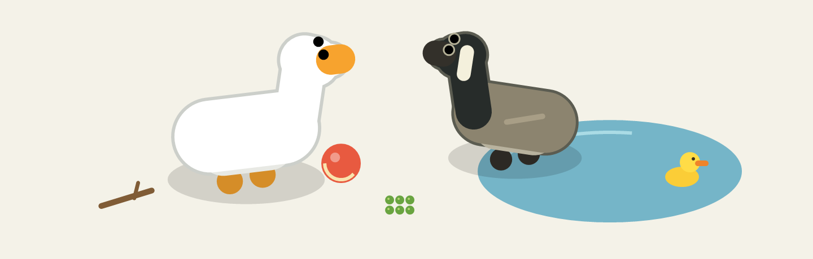

<div align="center">

# Goose on the Loose

**A little desktop chaos. A lot of goose.**

A spiritual successor to Desktop Goose, made for Windows 11.

[](docs/PLAYING.md#install-and-play) [](https://github.com/MichaelYelavich/GooseOnTheLoose/releases/tag/v0.4.0-beta.1) [](https://github.com/MichaelYelavich/GooseOnTheLoose/actions/workflows/ci.yml)



*An illustration made with the game's own renderer. The geese live on your desktop.*

[**Download Beta Release 1**](https://github.com/MichaelYelavich/GooseOnTheLoose/releases/tag/v0.4.0-beta.1) · [Player guide](docs/PLAYING.md) · [Roadmap](#roadmap) · [Report a bug](https://github.com/MichaelYelavich/GooseOnTheLoose/issues/new/choose)

</div>

## What is this?

**Goose on the Loose is an independent spiritual successor to [Desktop Goose by Samperson](https://samperson.itch.io/desktop-goose).** It keeps the desktop geese, adds toys, water and native tools, and focuses on reliability and performance.

Your goose wanders across your desktop, honks, fetches sticks and brings you pictures and notes. Add a Canada goose for company, drop a pond beside your work, or leave out a ball and see what happens. They can even steal your cursor when provoked.

Everything happens directly on the desktop. Controls live in the tray, and the Toy Box opens when you want it. No account is needed, and the game runs offline.

## What's here already

| | On your desktop |
| --- | --- |
| **Two geese** | A white goose and an optional Canada goose companion. Shared scarves, sunhats and size settings. |
| **A proper Toy Box** | Balls, fetch sticks, peas, rubber ducks, ponds, puddles and mud patches. Place up to 16 objects. |
| **Water and muddy feet** | Swimming, ripples, floating ducks and fading wet or muddy footprints. Clean water washes mud away. |
| **Personal mischief** | Geese deliver your pictures and ordinary text notes in small native windows. |
| **Room to adjust** | Pause, quiet mode, reduced motion and cursor-stealing preferences, plus editable behavior presets. |

Preferences and custom content persist. Toys, water, footprints and delivered windows start fresh each time you launch.

## Let them loose

| Download | What to do |
| --- | --- |
| [**Windows installer**](https://github.com/MichaelYelavich/GooseOnTheLoose/releases/download/v0.4.0-beta.1/GooseOnTheLoose-Beta1-Setup.exe) | Double-click to install for your Windows account. No administrator access needed. |
| [**Portable ZIP**](https://github.com/MichaelYelavich/GooseOnTheLoose/releases/download/v0.4.0-beta.1/GooseOnTheLoose-Beta1-windows.zip) | Extract the entire folder, then run **GooseOnTheLoose.exe**. Keep its companion files beside it. |

Requires **Windows 11**. Its included .NET Framework is sufficient; players don't need developer tools or an extra runtime download. Desktop and startup shortcuts are optional and off by default.

1. Launch the game and **right-click its tray icon** for controls.
2. Open **Toy Box** and drag a toy or patch of water onto the selected display.
3. Open **Options** to invite the second goose, choose an outfit or adjust the mischief.

**Need your cursor back?** Tap **Escape**. To dismiss everything, hold Escape for **five seconds** and watch the geese burst into cartoon feathers. Release early to cancel. Tray **Quit** or **Ctrl+Alt+Q** exits immediately.

The installer is currently unsigned. See the [player guide](docs/PLAYING.md) for installation, all shortcuts and cleanup controls.

## Make it yours

Use **Your content → Import Pictures** or **Edit Notes** in the tray menu. You can also open the content folder and edit the files yourself; changes reload while the game runs.

Fresh profiles use your Windows Documents folder:

```text
GooseOnTheLoose/
├── Pictures/               Your PNG, JPEG and GIF files
├── Notes/                  Ordinary text notes
├── Behaviors/default.json  Activity and toy-reaction settings
├── settings.json           Saved preferences
└── README.txt              Content and preset instructions
```

Existing **DesktopGoose2** collections stay where they are. Updates preserve your settings and content, and uninstalling keeps the Documents folder. Read the [customization guide](docs/PLAYING.md#your-content) for limits, legacy imports and behavior presets.

## Roadmap

The desktop companion comes first. These are priorities, not promised dates; beta feedback will help shape the details.

### Next · More personality, more play

- Give the geese more distinct habits, reactions and interactions with each other.
- Make the existing toys and water more interesting before filling the Toy Box with new things.
- Polish movement, expressive animation and reduced-motion behavior.
- Keep improving stability and performance using reproducible reports and local measurements.

### Then · A bigger desktop

- Let geese travel between monitors, with sensible placement for toys and delivered windows.
- Handle mixed display scaling, displays to the left or above the main screen, and reconnecting monitors.
- Test sleep, resume and display changes across a broader hardware setup before replacing the current selected-display model.

### Exploring · Better ways to make it yours

- Picture and note collections that are easier to organize.
- More documented behavior presets and clearer content tools.

The current beta uses **one selected display at a time**. See the [expanded roadmap](docs/ROADMAP.md) and [verification record](VALIDATION.md) for scope and remaining testing limits. Have an idea? [Suggest a feature](https://github.com/MichaelYelavich/GooseOnTheLoose/issues/new/choose).

## Build, contribute, improve

The source is public, and source updates are separate from downloadable releases. Ordinary commits and pull requests run the Windows checks; publishing a release is a separate, manual workflow.

On Windows 11, install **Git**, **PowerShell 7** and the exact **.NET SDK pinned in [global.json](global.json)**, then run:

```powershell
git clone https://github.com/MichaelYelavich/GooseOnTheLoose.git
cd GooseOnTheLoose
./build.ps1 -Locked
./tools/verify.ps1 -Interactive -Format
```

Players continue to use .NET Framework 4.8. The SDK is only for development. Installer packaging also needs Inno Setup; dependencies, build commands and contribution guidance are in [CONTRIBUTING.md](CONTRIBUTING.md).

## Find your way around

| Looking for… | Start here |
| --- | --- |
| Installation, controls, toys and custom content | [Player guide](docs/PLAYING.md) |
| Build instructions and dependencies | [Contributing](CONTRIBUTING.md) |
| How the application fits together | [Architecture](docs/ARCHITECTURE.md) |
| What's planned | [Roadmap](docs/ROADMAP.md) |
| What changed and what was tested | [Release notes](RELEASE_NOTES.md) · [Validation and known limits](VALIDATION.md) |
| How releases are prepared | [Release checklist](docs/RELEASING.md) |
| Background and original sound sources | [Research](RESEARCH.md) · [Sound provenance](Assets/Sounds/PROVENANCE.md) |

---

Inspired by **[Desktop Goose by Samperson](https://samperson.itch.io/desktop-goose)**. Goose on the Loose is an independent project; the original game's contribution and the source research behind this one are documented in [RESEARCH.md](RESEARCH.md).
